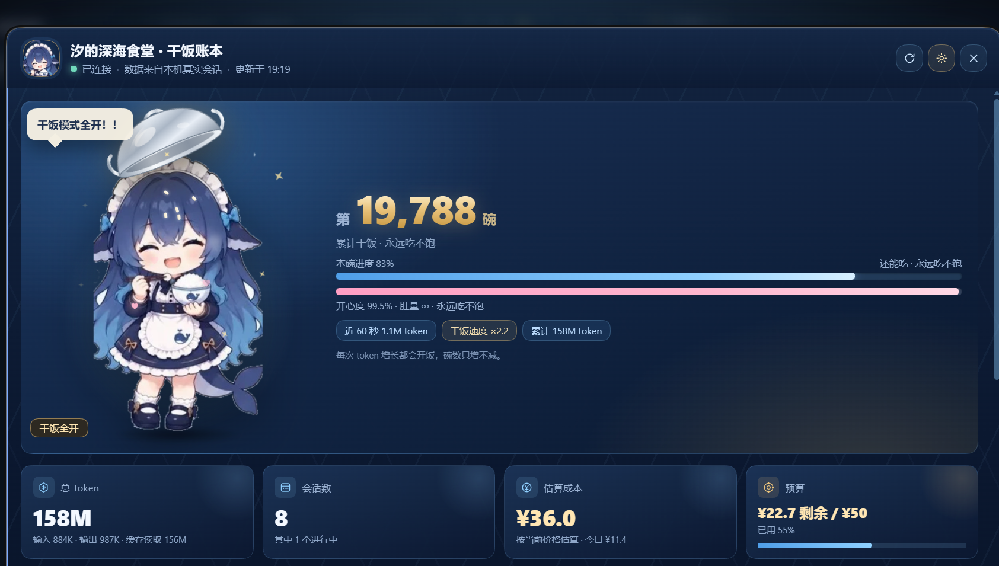
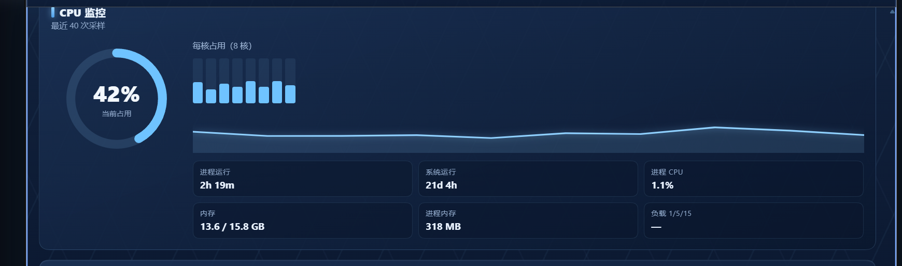
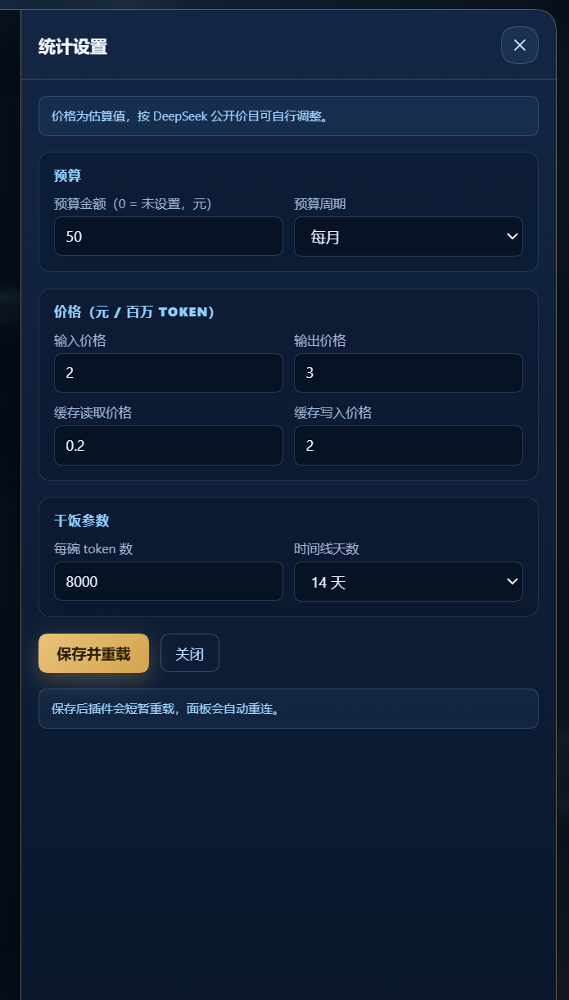
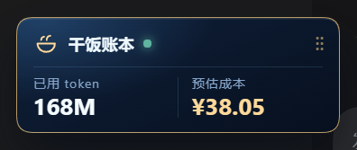

# 鲸鱼娘干饭账本 · whale-girl-stats

DSH Web GUI 的**真实会话数据统计插件**。它读取本机 DSH Session 日志里的真实 token 用量，统计总 Token、会话数、按价格估算的成本与预算，展示 14 天消耗时间线和逐会话明细，同时监控 CPU 占用与运行时长。

主题角色是鲸鱼娘「汐」：头顶一只不锈钢饭盆。**每当 Token 被消耗，她就把盆子端起来干饭**——吃得越快动画越快，累计 Token 越多碗数越多；她只会越吃越开心，永远不会吃饱。









---

## 已实现

- **入口与常驻状态窗**：侧边栏底部 `sidebar.footer.action` 的「干饭账本」按钮；另有一个常驻小状态窗，实时显示「已用 token / 预估成本」两项信息，可在 DSH 界面内任意拖动，位置保存在浏览器 `localStorage`，窗口缩放时自动收回可视范围；点击（不拖动）打开完整统计面板。默认停靠在左下角账号上方，不遮挡账号。
- **真实数据**：通过 Host 的 `sessionQuery` 服务读取本机全部会话（含当前活动会话），不读假数据、不依赖浏览器缓存。
- **总览 KPI**：总 Token（输入 / 输出 / 缓存读取分项）、真实会话数、进行中会话数、请求数。
- **成本估算**：按 DeepSeek 官方峰谷价与每条消息的模型自动计价（flash / v4-pro、cache hit/miss、输出、缓存写入按未命中输入价），也可切换为自定义单价；未知模型不虚构价格。
- **预算与告警**：支持「本月 / 累计」预算和可选日预算；80% / 100% 阈值可在面板显示醒目横幅，Host 可向 Webhook 推送一次告警（同一周期、同一阈值去重）；超支变红。
- **成本归因**：按模型 / 工作区 / 主会话 vs 子代理拆分成本、Token、请求和会话数；可切换「包含子代理 / 仅主会话」，所有总量与预算口径随之变化。
- **实时刷新**：创建 Session 或完成一次模型调用时通过 SSE 通知浏览器立即刷新，保留 3 秒轮询兜底。
- **Token 时间线**：最近 7 / 14 / 30 / 90 天逐日堆叠柱状图（输入 / 输出 / 缓存读取）+ 成本折线，hover 查看当天明细。
- **逐会话明细**：标题、更新时间、Token 分项、成本、请求数、模型、主会话 / 子代理、进行中 / 已归档；可排序、可展开；可导出 CSV。
- **历史与导出**：逐 Session CSV 导出（含模型、工作区、主/子代理、Token 分项、成本），便于做月度报表。
- **CPU 监控**：实时总占用、每核占用、进程 CPU、进程内存、系统内存、系统运行时长、进程运行时长、最近采样 sparkline。
- **干饭角色**：空闲时头顶饭盆等待投喂；检测到 Token 增长立即进入干饭——咀嚼弹跳、米粒从盆里落下、蒸汽、爱心、星星、气泡轮换；饭量随累计 Token 增长，速度随消耗速率提高，永远不显示“吃饱”。
- **设置**：面板内直接修改预算 / 日预算 / 告警阈值 / Webhook、计价模式、是否包含子代理、每碗 Token 数、时间线天数；写回插件配置并实时生效。
- **本地化**：简体中文 / English。
- **自带素材**：透明立绘、头像、插件图标；无第三方运行时依赖。

---

## 安装

在 DSH 插件管理器里添加本仓库地址：

```text
https://github.com/Holdon2099/dsh-whale-girl-stats
```

或用你所使用版本的 `dsh plugin add` 安装该 GitHub 仓库。安装后刷新页面，在侧边栏底部、Settings 旁边会出现「干饭账本」入口；点击打开统计面板。

> 插件会随 DSH 启动自动加载，Host 接口：`GET /api/whale-girl-stats/overview`。

---

## 数据来源

Host 端在 `index.js` 里通过 DSH 的公开服务读取：

- `ctx.get('sessionQuery').listSessions()` —— 全部逻辑会话（活动会话优先）。
- `ctx.get('sessionQuery').readSession(id)` —— 非活动会话的完整事件日志（读一次后缓存）。
- `ctx.sessions.list()` 与 `session.ownEvents()` —— 活动会话直接读内存中的事件，不重复读盘。
- `assistant/message` 事件上的 `usage` 字段是唯一的 Token 来源；`session/title`、`turn/start`、`user/message` 提供标题、轮次和空会话判定。
- `session/inheritedEventCount` 之前的继承事件会被跳过，避免 fork 会话重复计费。

Token 计数规则：

- `totalTokens = inputTokens + outputTokens + cacheReadTokens (+ cacheWriteTokens)`（优先使用 provider 返回的 `totalTokens`）。
- `inputTokens` 是**缓存未命中输入**，`cacheReadTokens` 是缓存命中输入；成本按每条消息的 model 和发生时间（Asia/Shanghai）选择峰/谷价。
- 官方峰谷价（¥/百万 token，2026-11-11 核对）：
  - `deepseek-flash`：缓存命中 0.04 / 0.02，未命中 2 / 1，输出 8 / 4；
  - `deepseek-v4-pro`：缓存命中 0.30 / 0.15，未命中 9 / 4.5，输出 27 / 13.5。
- 高峰：北京时间周一至周五 09:00–12:00、14:00–18:00（中国法定节假日为谷时）；其余时间谷时。缓存写入没有单独费用，按未命中输入价计费。
- 未知模型不计价（成本 0，并在 UI 提示）；可切换到自定义价目。

CPU 数据来自 Node `os` 模块与 `process.cpuUsage()`：Host 每 3 秒采样一次，保留最近 60 个点；Windows 上 `os.loadavg()` 恒为 0，因此面板显示 `—`。

---

## 角色逻辑

| 状态 | 触发 | 表现 |
|---|---|---|
| 空闲 | 最近 60 秒无 Token 消耗 | 头顶饭盆轻轻浮动，气泡轮换「快投喂」台词，开心度缓慢呼吸 |
| 干饭 | 检测到 Token 总量增加 / `rate.active` | 饭盆向上飘起并倾斜，米粒落下，角色咀嚼弹跳，蒸汽、爱心、星星，气泡变成「好耶！又来饭了！」 |
| 暴食 | 最近一分钟 Token 消耗超过阈值 | 动画速度提升到 2 倍以上，粒子更密集，气泡「干饭模式全开！！」 |

- 碗数 = `累计 Token / 每碗 Token 数`（默认 8000），面板显示「第 N 碗」和本碗进度。
- 开心度随累计 Token 单调上升，**封顶 99.5%，永远不会到 100% / 永远不会“吃饱”**；面板同时显示「肚量 ∞ · 永远吃不饱」。
- Client 每 3 秒轮询一次；相邻快照的 Token 增量、`rate.tokensPerMin`、`character.state` 共同驱动动画强度。面板关闭或页面隐藏时停止轮询。

---

## 配置

设置面板写回插件配置（`cordis.patch.yml` 中 `whale-girl-stats` 行的 `config`）：

```yaml
- id: whale-girl-stats
  name: "@local/whale-girl-stats"
  config:
    enabled: true
    includeSubagents: true       # false = 总量/预算/明细排除子代理
    budget:
      amount: 50          # 0 = 未设置预算
      period: month       # month | total
      dailyAmount: 0      # 0 = 不启用日预算
      alertThresholds: [80, 100]
      webhookUrl: ''      # 可选；阈值首次触发时 POST 一次
    pricing:
      mode: official        # official = DeepSeek 官方峰谷价；custom = 自定义单价
      inputPerM: 2          # 仅 custom 模式使用：缓存未命中输入价
      outputPerM: 8         # 仅 custom 模式使用
      cacheReadPerM: 0.04   # 仅 custom 模式使用
      cacheWritePerM: 2     # 仅 custom 模式使用
    tokensPerBowl: 8000
    timelineDays: 14
```

保存后 Host 先立即应用新值，再通过 `configEditor` 写回配置并重载插件；面板会提示“已保存，插件正在重载”。

---

## Host 路由

- `GET  /api/whale-girl-stats/overview` —— 完整统计快照（含 CPU、时间线、成本归因、预算告警、会话）。
- `GET  /api/whale-girl-stats/events` —— SSE：模型调用完成/回合结束时推送 `usage` 刷新信号。
- `GET  /api/whale-girl-stats/export.csv` —— 逐 Session CSV 导出。
- `GET  /api/whale-girl-stats/config` —— 当前配置。
- `POST /api/whale-girl-stats/config` —— 修改配置（仅本机回环地址）。
- `GET  /api/whale-girl-stats/assets/eating.webp`
- `GET  /api/whale-girl-stats/assets/idle.webp`
- `GET  /api/whale-girl-stats/assets/avatar.webp`

所有读取接口同源、只读；写配置接口限制本机回环。

---

## 结构

```text
whale-girl-stats/
├─ index.js            # Host：sessionQuery 聚合、成本/预算、CPU 采样、配置与路由
├─ client.js           # Client：侧边栏入口、可拖动状态小窗、统计面板、图表、干饭动画、设置
├─ assets/
│  ├─ eating.webp      # 干饭立绘（透明背景）
│  ├─ idle.webp        # 头顶饭盆等待立绘（透明背景）
│  └─ avatar.webp      # 头像
├─ locale/zh.json, en.json
├─ icon.svg
├─ cordis.patch.yml
├─ package.json
└─ README.md
```

---

## 验证状态

已在本机实际安装并做页面级验证（OS 截图 + UI Automation，不是只查注册表）：

- Bundle `@local/whale-girl-stats@1.2.0` 安装成功，`application: applied`，插件行 active；`sidebar.footer.action` 中 `whale-stats.footer` active，`shell.overlay` 中 launcher/dashboard active。
- **P1 实际 API 验证**：14 个会话、7 个子代理、约 684M token、成本约 ¥46.6；`budget.alerts` 在实际月预算 88% 时给出 80% 阈值告警；`breakdown.byModel/byWorkspace/byAgentType` 均有数据。
- **成本归因 UI**：时间线下「成本归因」卡片正常；「模型 / 工作区 / 主体」三个 tab 可切换；主体 tab 实测显示「主会话 ¥26.97 57.9% / 子代理 ¥19.62 42.1%」。
- **子代理口径**：实际 POST `includeSubagents=false` 后，会话 14→7、子代理 7→0、成本 ¥46.5→¥26.9；恢复后回到 14/7。日预算设为 ¥5 时实际触发 83.8% 告警；测试后恢复为不启用。
- **预算告警 UI**：月预算 88.6% 时顶部红色 banner 显示阈值 80%、已花/预算/周期；预算 KPI 卡同步变红。
- **导出**：Header「导出 CSV」按钮可见；实际请求返回 `text/csv`，含 session_id、主/子代理、workspace、models、token 分项、cost 等列。
- **SSE**：实际连接 `/api/whale-girl-stats/events` 收到 `hello` 帧（version 1.2.0）；面板打开时 EventSource 监听 usage 事件，失败时保留 3s 轮询兜底。
- 设置抽屉实测包含：统计范围（含子代理）、日预算、告警阈值、Webhook URL、「官方峰谷价 / 自定义单价」、时间线 7/14/30/90。
- Host 回归测试 13/13：含子代理过滤、breakdown、日预算、alerts、CSV、继承前缀、live→persisted 追平；`node --check index.js`、`node --check client.js` 均通过。
- 未验证：干饭动画逐帧、窄屏视觉、Webhook 实际推送（未配置地址）、浏览器原生通知（当前用应用内 banner）。

---

## 素材与版权

- 角色立绘与头像来自作者提供的角色三视图素材；版权归原作者，随本插件一起发布前已确认授权。
- `icon.svg` 为本插件绘制；`assets/icon-180.png` 由头像裁切生成，用于插件市场展示。
- 本插件代码无第三方运行时依赖。

---

## 已知限制

- 成本是**估算值**，不是运营商账单：官方价目和节假日表需要维护；Search / Fetch 按成功请求另行计费，未计入本插件。
- 官方价目核对日期为 2026-11-11；内置峰谷时段为北京时间，节假日表覆盖 2026 年；未知模型会显示「未计价」而不是猜测价格。
- 模型必须在 assistant/message 的 source 中可见；如果一次 Session 内切换模型，会按每条消息各自的模型计价。
- Token 只在 `assistant/message` 完成时写入日志，因此干饭动画会在一个 step 结束时爆发，而不是逐字流式增长；活动 Session 的尾部在两次轮询之间可能有短暂延迟。
- 历史会话首次加载会读完整日志（本机 1~5MB 压缩），之后按 revision 缓存；活动会话读内存，轮询成本很低。
- 插件统计的是本机 `~/.dsh/sessions` 下全部工作区的会话；不包含其他机器或其他 profile 的用量。
- Windows 上不显示 load average（显示 `—`）。
